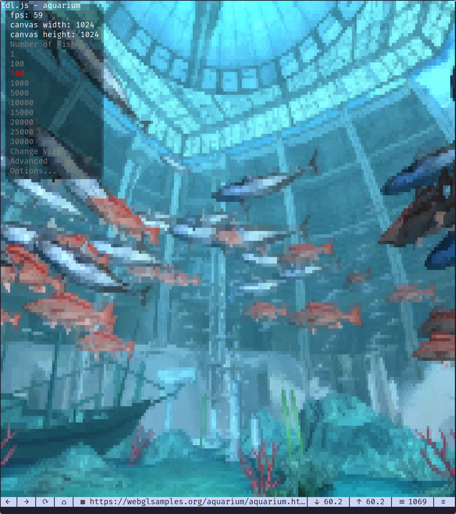
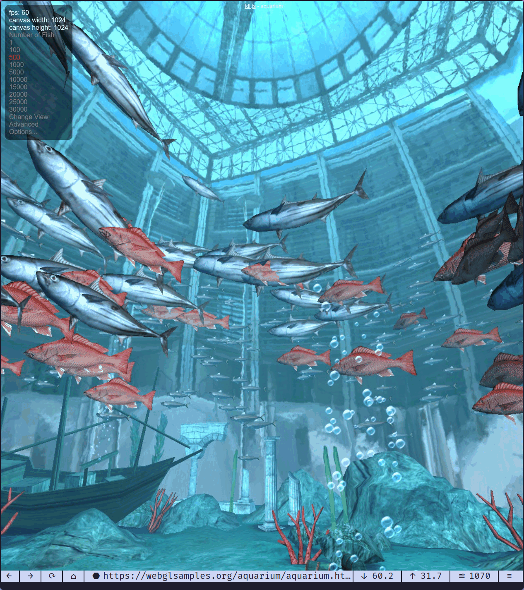
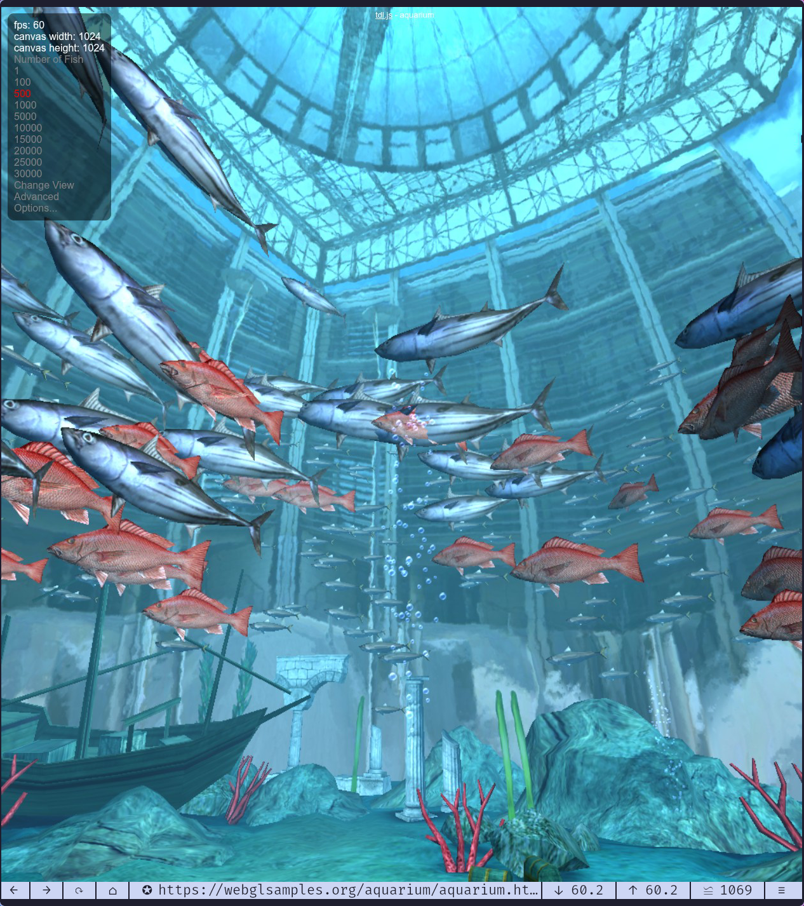

<h1 align="center">
  
  <br />
  Nyala
</h1>

<p align="center"><b>The fastest, bestest, most versatile web browser you never knew you needed 🦌</b><br /><i>...for your terminal.</i></p>
<p align="center">Made with 💝 for 🐧🍏</p>

Nyala renders real web pages, HTML5, CSS and JavaScript, in your terminal. It drives headless Chromium over the Chrome DevTools Protocol and composites a crisp Unicode text layer over a block bitmap, so text stays sharp instead of fuzzy. It runs wherever a TTY runs, down to a bare Linux console under [KMSCON](https://github.com/kmscon/kmscon), with no display server.

> [!IMPORTANT]
> **Young, but it works.** `nyala <url>` drives headless Chromium, streams a live screencast over the Chrome DevTools Protocol, and renders with the crisp text overlay on all three backends. Expect rough edges and breaking changes before 1.0.

<p align="center">
  
</p>

## Why Nyala?

Agentic development is moving to a terminal-first workflow. I started using [herdr](https://herdr.dev/) to organise my projects into "spaces", each with tabs for a coding agent, [lazygit](https://github.com/jesseduffield/lazygit) and [hunk](https://www.hunk.dev/), [gh dash](https://gh-dash.dev), the [fresh editor](https://getfresh.dev/), and [frogmouth](https://github.com/Textualize/frogmouth). Each space puts all my project tooling and reference at my fingertips, with one exception: a browser for project research and reference. So I made Nyala to fill that gap, taking inspiration from [browsh](https://www.brow.sh) and [carbonyl](https://github.com/fathyb/carbonyl). herdr is my preferred multiplexer for its agent integration, but [tmux](https://github.com/tmux/tmux) and [zellij](https://zellij.dev) are wildly popular, and agent-aware plugins will surely follow for both, so Nyala supports them too.

A nyala is a browsing antelope. Yes, that kind of browsing. It makes a fine mascot.

How the project got here, decision by decision, is written up in [`docs/EVOLUTION.md`](docs/EVOLUTION.md).

## Install

**Homebrew**
```bash
brew install wimpysworld/tap/nyala
```

**Nix**
```bash
nix run github:wimpysworld/nix-packages#nyala
```

**Docker**
```bash
docker run --rm ghcr.io/wimpysworld/nyala
```

**GitHub Actions**
```yaml
- uses: wimpysworld/nyala@v0
```

**Linux packages and binaries.** `.deb`, `.rpm`, `.apk`, Arch, and bare binaries are on [GitHub Releases](https://github.com/wimpysworld/nyala/releases). An AUR package `nyala-bin` is also available.

> [!TIP]
> The Nix package ships its own Chromium, so there is nothing else to install. Every other install method needs a Chromium on your system.

## Usage

Open a page:

```bash
nyala example.com
```

A bare host gains an `https://` scheme. The `http`, `https`, and `file` schemes are accepted; others are rejected. Nyala launches headless Chromium, streams the live page, and renders it to the TTY. The mouse works too: the wheel scrolls the page at the pointer, clicks reach the page, and dragging works on sliders, maps, scrollbars, and page text. Pages also see the pointer move, so links highlight under it and menus that open on hover open.

Nyala needs a Chromium executable at runtime. It resolves the path from `--browser`, then `NYALA_BROWSER`, then `CHROME_PATH`, then a `PATH` lookup.

Nyala keeps cookies, logins, site data, and browser settings between runs. It resolves the profile directory from `--profile`, then `NYALA_PROFILE`, then `$XDG_DATA_HOME/nyala/profile`, then `~/.local/share/nyala/profile`. The last path is the normal default when the environment does not override it.

Choose another persistent profile or start with a disposable one:

```bash
nyala --profile /path/to/nyala-profile example.com
nyala --private example.com
```

`--private` ignores `--profile`, `NYALA_PROFILE`, and the default persistent profile. To clear saved browser state, stop every Nyala process that uses the profile, then delete the resolved profile directory.

> [!WARNING]
> chromedp launches Chromium with `--password-store=basic` and `--use-mock-keychain`. Saved passwords are stored in the plain `Login Data` file inside the profile, not in the desktop keychain. Protect the profile directory as sensitive data.

Behind a proxy? Nyala reads the standard proxy environment variables and routes Chromium through them. It honours `HTTPS_PROXY`, `HTTP_PROXY`, and `ALL_PROXY` (and their lowercase forms), with `NO_PROXY` for hosts to skip. A proxy URL with credentials works too. Nyala authenticates over the DevTools Protocol, so the credentials stay out of the process arguments.

| Flag | Default | Description |
|---|---|---|
| `<url>` | required | Page to open. |
| `--browser` | auto | Path to the Chromium executable to drive. |
| `--profile` | `~/.local/share/nyala/profile` | Persistent browser profile directory. `NYALA_PROFILE` and `XDG_DATA_HOME` can change the default. |
| `--private` | off | Use a disposable browser profile and ignore persistent profile settings. |
| `--backend` | `auto` | Renderer backend: `auto`, `block`, `kitty`, or `sixel`. `auto` picks the terminal's best supported backend. A named backend sets the starting renderer and fails fast if the terminal cannot run it. |
| `--blocks` | `auto` | Block glyph mode: `auto`, `sextant` (2x3), or `quadrant` (2x2). `auto` picks sextant on terminals known to self-draw it, read from a static allow-list of environment variables, and quadrant elsewhere. |
| `--color` | `auto` | Block colour mode: `auto`, `truecolor`, `256`, or `ansi-grey`. |
| `--disable-frame-rate-limit` | off | Disable Chromium's browser frame-rate limit for benchmark testing. Does not control terminal or display synchronisation. |
| `--version` | | Print the version and exit. |

### Block colour modes

Colour mode precedence is an explicit non-`auto` `--color` value, then `NO_COLOR` for `auto`, then detection. Detection treats `COLORTERM=kmscon`, `COLORTERM=truecolor`, or `COLORTERM=24bit` as `truecolor`, even without a TTY. Every other profile, TTY or not, starts in `256`, the floor mode every remaining colour mode builds on. The capability for the colour cycle is floored at `256` on a real TTY. A permitted explicit value selects that exact starting mode. `NO_COLOR` selects the greyscale `ansi-grey` start; greyscale output still emits SGR colour codes.

| Mode | Block output | Automatic selection |
|---|---|---|
| `truecolor` | 24-bit foreground and background colours. | A truecolour profile or recognised truecolour `COLORTERM` value. |
| `256` | Canonical xterm palette indexes 16..255. | Every profile below truecolour. |
| `ansi-grey` | The fixed xterm greyscale ramp at indexes 232..255. | Never. |

<kbd>Alt</kbd>+<kbd>C</kbd> cycles `truecolor` -> `256` -> `ansi-grey`, then wraps. Nyala skips modes above the effective terminal capability. An explicit mode can raise a lower detected capability, but a terminal safety rule can still lower it. `NO_COLOR` changes the automatic starting mode only. It does not lower the detected capability for the cycle.

The `256` mode uses the CIEDE2000-nearest canonical xterm colour. `ansi-grey` quantises by luma only: it maps the Rec.601 key to the nearest fixed xterm grey.

> [!NOTE]
> Both remaining degraded outputs use only indexes 16..255, which terminals do not customarily redefine.

### Keys

| Binding | Action |
|---|---|
| Printable keys | Type into the focused page field |
| <kbd>Space</kbd> | Type a space in a focused field, otherwise scroll down |
| <kbd>Backspace</kbd> | Delete backwards in the focused page field |
| <kbd>Del</kbd> | Delete forwards in the focused page field |
| <kbd>Esc</kbd> | Send Escape to the page |
| Paste | Insert the clipboard into the focused page field |
| <kbd>Ctrl</kbd>+<kbd>F</kbd> | Find on the page; <kbd>Enter</kbd> searches, <kbd>Down</kbd> / <kbd>Up</kbd> step the matches, <kbd>Esc</kbd> closes |
| <kbd>Ctrl</kbd>+<kbd>A</kbd> | Select all: the focused field's text, or the whole page when nothing is focused |
| <kbd>Alt</kbd>+<kbd>W</kbd> | Copy the page selection to the terminal clipboard; the bar reports the result |
| <kbd>↑</kbd> <kbd>↓</kbd> <kbd>←</kbd> <kbd>→</kbd> | Move the caret in a focused field, otherwise scroll by one line step |
| <kbd>PgUp</kbd> / <kbd>PgDn</kbd> | Move the caret by one page in a focused field, otherwise scroll by one viewport height |
| <kbd>Home</kbd> | Move the caret to the line start in a focused field, otherwise scroll to top |
| <kbd>End</kbd> | Move the caret to the line end in a focused field, otherwise scroll to bottom |
| <kbd>Tab</kbd> | Focus next page element |
| <kbd>Shift</kbd>+<kbd>Tab</kbd> | Focus previous page element |
| <kbd>Enter</kbd> | Activate focused element |
| <kbd>Alt</kbd>+<kbd>Home</kbd> | Open home page (the URL Nyala was launched with) |
| <kbd>Ctrl</kbd>+<kbd>R</kbd> | Reload page |
| <kbd>F5</kbd> | Reload page |
| <kbd>Alt</kbd>+<kbd>Left</kbd> | Go back |
| <kbd>Alt</kbd>+<kbd>Right</kbd> | Go forward |
| <kbd>Ctrl</kbd>+<kbd>Q</kbd> | Quit |
| <kbd>Ctrl</kbd>+<kbd>C</kbd> | Interrupt |
| <kbd>Alt</kbd>+<kbd>R</kbd> | Cycle rendering backend |
| <kbd>Alt</kbd>+<kbd>Shift</kbd>+<kbd>R</kbd> | Cycle rendering backend backwards |
| <kbd>Alt</kbd>+<kbd>B</kbd> | Cycle Block mode: Quadrant -> Sextant, plus Shaded when the colour mode is 256 or ANSI grey (Block backend only) |
| <kbd>Alt</kbd>+<kbd>Shift</kbd>+<kbd>B</kbd> | Cycle Block mode backwards (Block backend only) |
| <kbd>Alt</kbd>+<kbd>C</kbd> | Cycle colour mode: Truecolour -> 256 -> ANSI grey (Block backend only) |
| <kbd>Alt</kbd>+<kbd>Shift</kbd>+<kbd>C</kbd> | Cycle colour mode backwards (Block backend only) |

Notes:

- Typing goes to the page, so plain `q` does not quit. Use `Ctrl+Q`. Chromium decides what each key does, which is why `Space` types in a focused field and scrolls the page otherwise, and why the arrows, `Home`, `End`, `PgUp`, and `PgDn` move the caret in a focused field and scroll the page when nothing is focused.
- A paste arrives as one unit, up to 1 MiB, so a pasted newline never submits a form by accident. Inside the URL editor and the find field the paste lands there instead. Paste into the page with no field focused and the bar says the paste was discarded, because Chromium drops it.
- Select page text by dragging, double-clicking a word, triple-clicking a line, or pressing `Ctrl+A`. Chromium decides what `Ctrl+A` takes: the focused field's text, or the whole page. Inside the URL editor and the find field it keeps its readline meaning and moves to the line start. Selecting copies nothing; `Alt+W` or the ☰ menu's Copy sends it to the clipboard over OSC 52. Selections over 74,994 bytes are refused rather than truncated, so a silent half-copy cannot happen. `Shift`-drag is still your terminal's own selection.
- Hover needs a terminal that reports pointer motion. Some terminals stop reporting it while their window is unfocused, so hover pauses until you focus the window again, and a few older terminals never report it at all. Clicks, drags, and the wheel are unaffected either way.
- A copy reports itself in the bottom bar: the bytes it wrote, or why an over-long selection was refused. The line takes the URL region for two seconds and then the URL comes back; nothing is blocked while it shows.
- Find searches when you press `Enter`, not as you type, because each search repaints every match in the page. Matches highlight amber and the current one orange. `Shift+Enter` steps back as well, on a terminal that speaks the Kitty keyboard protocol; `Down` and `Up` work everywhere.
- `Alt+Home` returns to the URL Nyala was launched with, for the lifetime of the process. It is a normal navigation, so `Alt+Left` goes back to the page you were on.
- The Block mode and colour cycles skip modes the terminal cannot render (see [Terminal compatibility](#terminal-compatibility)).
- Both cycles only work while the Block backend is on screen. They only affect Block rendering, so cycling them under Kitty or Sixel would change hidden state with no visible feedback.
- A multiplexer with custom Alt binds can shadow the Alt chords. The zellij defaults leave `Alt+R`, `Alt+B`, and `Alt+C` free.

## Rendering

Three backends sit behind one `Renderer` seam. Swapping backend changes the renderer and nothing above it.

| Backend | Protocol | Fidelity | Notes |
|---|---|---|---|
| **Block** | None; plain Unicode glyphs | Universal floor | Any TTY, including a bare Linux console. Two schemes: sextant (2x3) and quadrant (2x2, the fallback). Colour modes range from truecolour to greyscale. |
| **Sixel** | Sixel graphics | Higher | Bitmap output with a temporally stable adaptive palette. |
| **Kitty** | Kitty graphics | Highest | Two transports. Shared memory, probed at startup: decoded raw RGBA handed over POSIX shared memory. Direct fallback: Chromium's PNG passed straight to Kitty framing, no decode, no re-encode. |

Nyala detects the terminal and picks the highest-fidelity backend it supports: Kitty, then Sixel, then Block. Block is the floor because it needs no graphics protocol at all. Press Alt+R to cycle the backends your terminal supports, or click the backend indicator in the bottom bar; a right-click cycles backwards. Live frames stream as JPEG q90, except direct Kitty, which passes Chromium's PNG through untouched.

The same page on each backend, in ascending fidelity.

<details>
<summary><b>Block</b>, Unicode glyphs on any TTY</summary>



</details>

<details>
<summary><b>Sixel</b>, a bitmap where the terminal speaks it</summary>



</details>

<details>
<summary><b>Kitty</b>, full pixels over shared memory</summary>



</details>

### Performance: the fastest and highest fidelity terminal browser

Nyala is the fastest terminal browser, and the highest fidelity one. On the WebGL Aquarium it draws 85.5 fps through Block, 3364 of the 3374 frames Chromium delivered. It renders the full terminal surface at full resolution, where four of the five other terminal browsers magnify or downscale the page by default. The measurements, the source audits, and the cases where a rival beats Nyala are in [`docs/COMPARISON.md`](docs/COMPARISON.md).

| Backend | Terminal | Cap | Frames drawn |
|---|---|---|---|
| Block | kitty 0.47.0 | uncapped | 85.5 fps |
| Kitty graphics | kitty 0.47.0 | uncapped | 71.5 fps |
| Sixel | Alacritty 0.17.0 | default 60 fps | 19.4 fps |

WebGL Aquarium at 2560x1440. The terminal sets the Sixel rate, not Nyala: on Alacritty the write costs 51.1 ms per frame against 25.5 ms for Nyala's entire encode. Sixel stays capped because uncapping it only adds contention and drops more frames.

Sextants split a cell into three rows where quadrants split it into two, so Block resolves 1.5 times the vertical detail.

Design rationale and the full measurement record live in [`docs/ARCHITECTURE.md`](docs/ARCHITECTURE.md).

### Terminal compatibility

Block shows the glyph mode Nyala auto-selects; `--blocks` overrides it. Yes under Sixel or Kitty means the protocol works in that terminal. No can also mean Nyala disables a protocol to dodge a terminal-side limit. Terminals disagree on the cell-pixel units they report, but Nyala normalises layout density, so every terminal lays out the same page at the same text size.

| Terminal | Block | Sixel | Kitty | Notes |
|---|---|---|---|---|
| Alacritty | Sextant | Yes | No | Sixel works in the tested environment; stock upstream differs. Built-in sextants can show a one-pixel seam. |
| Contour | Sextant | Yes | Yes | Kitty graphics need Contour 0.7 or newer. |
| Foot | Sextant | Yes | No | |
| Ghostty | Sextant | No | Yes | No Sixel support. |
| Kitty | Sextant | No | Yes | Native protocol. Shared-memory fast path where available, direct PNG fallback. |
| mlterm | Quadrant | Yes | No | High-cardinality Block colours can be sparse in the compact-truecolour build; use `--color=256`. |
| Rio | Sextant | No | Yes | See the Rio 0.4.x note below. |
| WezTerm | Sextant | Yes | Yes | Sixel is documented as preliminary. |

That Sixel spread is not new, and it widens across more terminals. In an earlier run at 2560x1600, Nyala's own cost held constant (decode 13.0 to 13.7 ms, encode 28.3 to 30.3 ms) while delivered frames ranged 13x: mlterm 22.9 fps, Alacritty 17.5, foot 8.1, Contour 4.0, WezTerm 1.8.

> [!NOTE]
> **Rio 0.4.x.** Rio advertises Sixel but does not render it, so Nyala excludes Sixel from auto backend selection. Rio's style table caps truecolour, so auto colour uses the xterm-256 palette. `--color=256` and `--color=ansi-grey` remain available. `--color=truecolor` is rejected. Kitty graphics work, with the live fps badge omitted.

#### Multiplexers

Host mode means the Block glyph mode follows the outer terminal. Nyala never offers the Kitty backend under a multiplexer.

| Multiplexer | Block | Sixel | Kitty | Notes |
|---|---|---|---|---|
| tmux | Host mode | Yes | No | Needs tmux 3.6+ built with `--enable-sixel` (3.6b+ recommended). Bottom row reserved; Sixel auto-selected. |
| zellij | Host mode | No | No | Sixel blocked by upstream zellij defects. |
| GNU screen | Host mode | No | No | No graphics passthrough. |
| herdr | Host mode | No | No | Consumes graphics sequences. |

> [!WARNING]
> zellij and herdr consume graphics sequences, so you get Block only. Run Nyala outside the multiplexer for Kitty or Sixel output.

## Development

Enter the pinned environment with `nix develop`, then run `just` to list the recipes. `just test` runs the fast unit-test gate. `just build`, `just test`, and `just lint` must pass after any code change, and `just check` runs the full pre-commit gate.

### Diagnostics

```bash
just diagnostics
```

`just diagnostics` runs the browser-free image-quality harness, independent Block, Kitty, and Sixel protocol checks, and Chromium-fed corpus placement, paint, and scroll checks. It writes gitignored evidence to `testdata/diagnostics/` and exits non-zero when a required leg fails.

> [!TIP]
> `just diagnostics` is the single correctness gate. The four `*-interop` recipes below are development selectors for working on one leg. They do not replace it.

<details>
<summary>The four interop selectors</summary>

| Recipe | What it checks |
|---|---|
| `just block-interop` | Two frames through the production Block compose and live cell-diff encoder. An independent VT emulator decodes the CUP, SGR, and UTF-8 byte stream, then its final cell model is compared with the grid the compose seam returned. |
| `just kitty-interop` | PNG and RGB frames through the production viewer and Kitty encoder, read back by an offline terminal model: control fields, 4096-byte chunk ordering and continuation, base64 reconstruction, PNG and zlib decoding, dimensions, exact pixels, double-buffer image IDs, and replacement deletes. |
| `just sixel-interop` | Nyala's complete production DCS output decoded by both go-sixel and libsixel's `sixel2png`, compared on dimensions and pixels. The flake exposes this gate for every supported system. Libsixel is a test tool only, not part of Nyala's package or runtime closure. |
| `just cdp-interop` | Representative local HTML fixtures loaded in Chromium. Settled production frames go through Block, Kitty, and Sixel, and the independently decoded terminal output is checked. Evidence lands in `testdata/diagnostics/cdp-interop/`. No timing assertions. |

None of these replace a physical terminal. They check Nyala's byte stream and repaint state without a TTY, so they say nothing about a terminal's font choice, glyph metrics, ambiguous-width policy, colour profile, inter-row bleed, escape passthrough, image anchoring, alpha blending, or repaint timing. `just kmscon-testcard` and live terminal runs cover those. Nyala has no general recording mode or diagnostic bundle format. [`docs/ARCHITECTURE.md`](docs/ARCHITECTURE.md) explains why each gate is drawn where it is.

</details>
